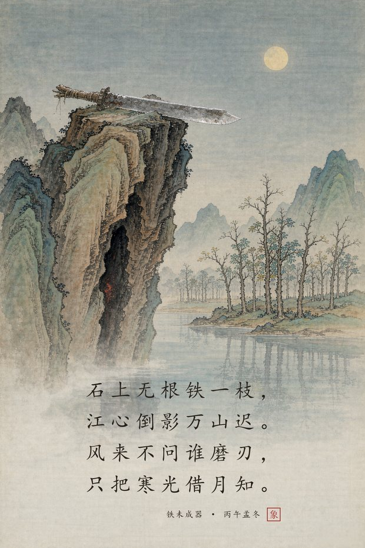

# 八字成象 · ps-bazi-chengxiang

> **象法定物，物落成景。** 把一副八字还原成一幅画：先从结构里取出「我是谁 / 我要什么 / 什么在挡我」三件东西，按盲派取象法译成画面母题，让整幅画只承载命局里最锋利的那一对相反力；再在画脚横题四句禅诗点破，另附一段不提干支、不用术语的白话——说清这道矛盾的来处与出口。

> **当前版本 v1.3.1**｜配图青绿淡彩，题诗横排压底，交付单文件 HTML 报告（图＋诗＋白话＋赞赏码＋体验邀请）。新用户只给一句「画一个」时，先按第 0 步一次问全三样信息。

## 一、它做什么

| | |
|---|---|
| **输入** | 四柱（年月日时干支）＋ 性别；只给生日走排盘器 |
| **输出** | 一幅竖幅山水（青绿淡彩，1024×1536）＋ 四句七言 ＋ 白话解析（核心矛盾＋破局三条）＋ 一份可转发的单文件 HTML |
| **不做** | 不断贵贱祸福、不排大运应期、不做决策依据——那些归 `ps-zonglun` 与其他子技能 |

它只做一件事：**译象为画**。断法是别人的事，取象有专门的表，这一层只负责「把算出来的力，翻译成看得见的景」。

### 第一次用，会先问你三样

装上之后你只要说「帮我把八字画出来」，它不会先讲一堆流程，而是发这么一条：

> 给我三样东西就能开画：
>
> **1. 性别**：男 / 女
> **2. 出生**：公历哪年哪月哪日 ＋ 几点（尽量到小时，例：1990年5月12日 14:30）
> **3. 出生地**：省市就行（只在需要校正出生时刻时用到，不确定可以跳过）
>
> 下面两项不给就用默认——
> · **画的调子**：青绿淡彩（默认）／水墨／宋人小品／极简禅画
> · **要不要题诗**：默认题四句
>
> 手上已经有八字的话（比如排盘软件里那串「庚午 辛巳 丁丑 丁未」），把它和性别一起发我最快，中间那步就省了。
>
> 只做画，不出断命报告；出生信息只用于这一次成象。

**为什么是这三样**：性别定夫妻星的口径（白话里点不点配偶），出生年月日时定四柱——四柱就是画里那三件物（我／求／障）与画眼的来处；出生地只在「只给生日、需要校正出生时刻」时才用得上，所以标了可跳过。

**时辰记不清也行**：问一次白天还是夜里，仍定不了就按年、月、日三柱成象，画里少时柱那一件物，报告里注明「时辰未定，时柱之象从略」。**不会替你猜一个时辰**——猜出来的时柱，对应的物就是错的。

## 二、看一眼成品



这副命（庚金坐戌，水旺而空，甲乙木满盘为财全在彼岸）取三件物：

- **一把未开刃的长刀** 横陈崖顶——庚为刃，戌中丁火不透，无火不器，刃口钝重、覆一层薄霜
- **一片疏林** 在对岸，枝干挺直如戟——满盘财星，看得见、够不着
- **一条空江** 卧在中间，倒影比实物淡一层——水落空亡，江是虚的，无桥无舟

矛盾只有一句：**手中有刃，刃下无石；万木在对岸，舟不来。**

```
石上无根铁一枝，
江心倒影万山迟。
风来不问谁磨刃，
只把寒光借月知。
```

起句落在「石与铁」，承句把虚影与实山对起来，转句问而不答——正因缺火炼；末句不喊口号，只写「借月自照」，所求便是自成其器，不在外财。

完整拆解见 `references/示例_庚戌坐戌.md`，成品见 `examples/庚戌坐戌/`（含象稿、提示词、无字底片、成品图、HTML 报告）。

第二例 `examples/戊辰乙卯辛酉戊戌/` 是另一副完全不同的骨（辛金坐酉，财当令，双印夹日，卯酉与辰戌两重相冲）。它示范「**合象**」：单字表里辛是「针／剑／珠玉」、酉是「碑／金石」，硬查只能画一把剑立在碑上，出不了「照见」这个动作；拼成一面铜镜，整幅画的矛盾——**照得见，够不着**——才立得住。

## 三、成象七步

```
锁四柱 → 定结构 → 取象 → 定矛盾 → 写象稿与白话 → 出图 → 题诗上画（→ 合成报告）
```

| 步 | 做什么 | 关键约束 |
|---|---|---|
| 1 锁四柱 | 拿四柱，缺柱或时辰存疑先走校时 | **没有可靠四柱就不画**，画错一格画面全错 |
| 2 定结构 | 只取「我／求／阻」三样 | 不算做功大小——画不看层次高低，只看力的形状 |
| 3 取象 | 查 `references/取象译画.md` 逐项对；**日主＋坐支要拼成一件物**（辛＋酉＝铜镜，庚＋戌＝刀在崖） | 同字多象时用「十神＋宫位」锁一个，锁不死取最能入画的；拼不出就退回单字，别三合一 |
| 4 定矛盾 | 一句话写死一对相反力，≤30 字 | 写不出这句 = 第 2 步没取准，回去重取 |
| 5 象稿＋白话 | 填满八格表；写核心矛盾三句＋破局三条 | 白话里**不许出现干支、星名、术语**；破局第三条要具体到今晚能做 |
| 6 出图 | 拼 prompt 调生图，竖幅 1024×1536 | 先出**无字画**；题字区用「底部雾带」一次解决 |
| 7 题诗上画 | 先写诗，再用 `tools/tieshi.py` 叠字 | **文字永远不在生图里画** |

### 五条铁律

1. **象从结构来，不许凭空造景。** 画里每件东西都要能指回某一柱、某一字、某一关系；指不回去的删掉。
2. **一画一矛盾。** 整幅只承载最锋利的那一对相反力。多中心＝没有中心。
3. **诗不写术语，只写物。** 不得出现官杀、财星、用神、空亡、格局，也不得出现「可能／运势／命中注定」。
4. **交付里不出现四柱。** 图上不题干支，回复里不列八字——用户要的是画和「我是怎么回事」，不是排盘单。
5. **文字只由脚本加。** 生图模型写中文必出错，一律先出无字画，再用脚本叠。

## 四、目录

```
psbzcx/
├── SKILL.md                     # 技能入口：七步流程 + 五条铁律 + 四档风格 + 十一种翻车
├── references/
│   ├── 取象译画.md               # ★ 核心：干支/十神/作用关系/宫位/五行 → 画面母题的映射表
│   ├── 成象卡.md                 # 八格象稿表 + 提示词骨架 + 迭代规则（说"太满/太素"时改哪一段）
│   ├── 禅诗法.md                 # 起承转合分工、一韵到底、禁用清单、正反例
│   ├── 白话解析.md               # 矛盾三段式 + 破局三条 + 去术语清单
│   └── 示例_庚戌坐戌.md          # 完整走通的一例（few-shot）
├── tools/
│   ├── tieshi.py                # 题诗上画：横排/竖排、雾带、去水印、羽化接缝
│   └── report/
│       ├── build.py             # 压图 + base64 内嵌 → 单文件 HTML
│       └── 报告模板.html         # 只改文字的版式模板（3 个图片占位符）
├── assets/                      # 赞赏码 + 微信名片（build.py 默认取这里，可替换）
└── examples/
    ├── 庚戌坐戌/                 # 一柄未开刃的刀（庚金坐戌）——全流程含无字底片
    └── 戊辰乙卯辛酉戊戌/          # 一面立在碑上的铜镜（辛金坐酉）——示范「合象」
```

## 五、安装

```bash
git clone https://github.com/watchkd/psbzcx.git ~/.workbuddy/skills/ps-bazi-chengxiang
```

或直接把这个目录拷进 `~/.workbuddy/skills/ps-bazi-chengxiang/`（目录名须与 `SKILL.md` 里的 `name` 一致）。

**依赖**：

- Python 3 ＋ `Pillow`（`pip install pillow`）—— 两个脚本只依赖它，纯本地、不联网。
- `ps-zonglun`（**可选**）—— 只在「只给生日、需要排四柱」时用到它的 `tools/paipan.py`；有现成四柱就不需要。

若与多个命理技能共存，建议只让入口参与自动调度：

```json
// ~/.workbuddy/settings.json
{ "skillOverrides": { "ps-bazi-chengxiang": "user-invocable-only" } }
```

## 六、两个脚本

### `tools/tieshi.py` · 题诗上画

```bash
python tools/tieshi.py --image 图_无字.png --layout h \
  --poem "石上无根铁一枝，|江心倒影万山迟。|风来不问谁磨刃。|只把寒光借月知。" \
  --sign "铁未成器 · 丙午孟冬" --seal 象 --out 成象_题诗.png
```

| 参数 | 作用 |
|---|---|
| `--layout h` / `v` | 横排压底（默认）／竖排沿一侧 |
| `--poem` | 用 `|` 分隔每句；横排带标点，竖排不带 |
| `--h-span` `--text-width` `--bottom` | 文字块高度占比／行宽占比／离底边距，一般不用手调 |
| `--veil 0-100` | 题字带压一层淡纸色，**整幅宽自上而下渐入**，像江面起雾，不留矩形边 |
| `--wm-box x0,y0,x1,y1` | 按纸色填掉平台水印（先裁一小块确认范围） |
| `--feather N` | 仅竖排：从第 N 像素起把右侧羽化为纸色，消掉硬留白条接缝 |
| `--font kai/song/hei` `--font-path` | 换字体 |

字号由「单行最宽」与「四行总高」自动求，不用手填。

### `tools/report/build.py` · 合成单文件报告

```bash
python tools/report/build.py \
  --tpl tools/report/报告模板.html --out 成象报告.html \
  --color 成象_题诗.png
```

赞赏码与微信名片**默认取 `assets/`**，不传参即可；`assets/` 里换成你自己的，或用 `--appreciation --wechat` 指别的图。**缺图时那张卡片会整块从报告里去掉**，不会留破图。

图片自动压到 1024／520／440 宽再 base64 内嵌，单文件约 550KB，断网、转发、打印都能用。模板里**只改文字**，结构与样式不动。已内置交互：点画放大（滚轮缩放、拖动移视、双击复位）、点诗句出注、破局「记下」（localStorage 留存）、复制诗句与微信号、存图、打印／存 PDF、手机端单栏。

**v1.3.2 修「报告点不开」**：旧模板把 `[data-reveal]` 直接设成 `opacity:0`，靠内联脚本淡入——聊天窗口、阅读器、带 CSP 的预览器一旦屏蔽脚本，整页就是一片空白（用户看到的就是「点不开」）。现在样式**默认可见**，只有脚本真的跑起来才挂 `.js` 做动画。`build.py` 构建后会自动自检：结构、UTF-8、占位符残留、内嵌图数量、体积、无脚本可读性，任何一项不合格直接报错退出，不把半成品交出去。

**交付**：报告是单文件 HTML，**本地路径在聊天窗口里点不开**。上传到网盘／静态页／CDN 后把链接发给用户；加 `--ascii-copy` 会额外落一份纯英文名的 `report.html`，链接里不会被中文名转义。

```bash
# 带英文名副本
python tools/report/build.py --tpl tools/report/报告模板.html \
  --out 成象报告.html --color 成象_题诗.png --ascii-copy
```

## 七、四档风格

| 档 | 画面语言 | 何时用 |
|---|---|---|
| **青绿淡彩**（默认） | 绢本设色：墨线立骨，石青石绿淡染山与林，赭石染崖，朱砂一点提神，藤黄染月 | 绝大多数命 |
| 水墨单色 | 焦墨写主体，淡墨写远，赭石染根，一点朱砂；留白四成以上 | 明确要"水墨""黑白""素一点" |
| 宋人小品 | 绢本设色、工致、团扇式构图、题诗在外 | 女命、文气重的命 |
| 减笔禅画 | 极简，一物一影，笔断意连 | 结构极简、矛盾极锐的命 |

风格只改画面语言，**不改取象结果**——象是算出来的，不是画出来的。

## 八、边界

- 命理属传统文化范畴，本技能产出的是**图像与文字作品**，不是预测，不构成任何决策、医疗、投资建议。
- 取象语汇承自盘叔盲派技能包（段氏理象学类象、象法七原则），本仓库只做「译象为画＋题诗＋白话」这一层，不含断法正文。
- `assets/` 内的赞赏码与微信号、报告里的体验邀请链接均为作者本人的；**替换成你自己的再发布**。

## 九、许可

个人学习与研究使用。转载、二次分发请保留出处与作者标识。
